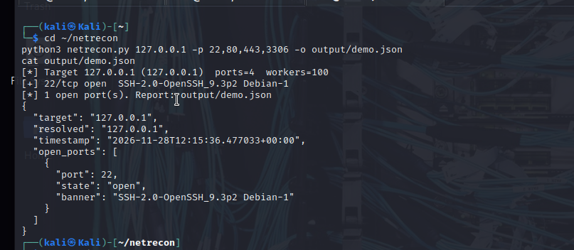

# netrecon

Authorized-use host/port reconnaissance with structured JSON output, built for
pipeline use rather than interactive scrolling.

## Problem
Most quick recon tools print to the terminal and stop there. netrecon produces
a machine-readable report so results can be diffed between runs, fed into
detection tests, or ingested by a scanner pipeline.

## Design
- Threaded connect scan (`concurrent.futures`) — fast enough for /24 lab ranges
- Per-port banner grab with protocol-aware probes
- UTC-timestamped JSON output for reproducibility and diffing
- Stdlib only — no dependencies to break in CI

## Scope / authorized use
**Only run against systems you own or have written permission to test.**
Intended for home labs and explicitly authorized engagements.

## Usage
```bash
python netrecon.py 127.0.0.1 -p 1-1024
python netrecon.py scanme.nmap.org -p 22,80,443 -o out/scan.json

## Demo


